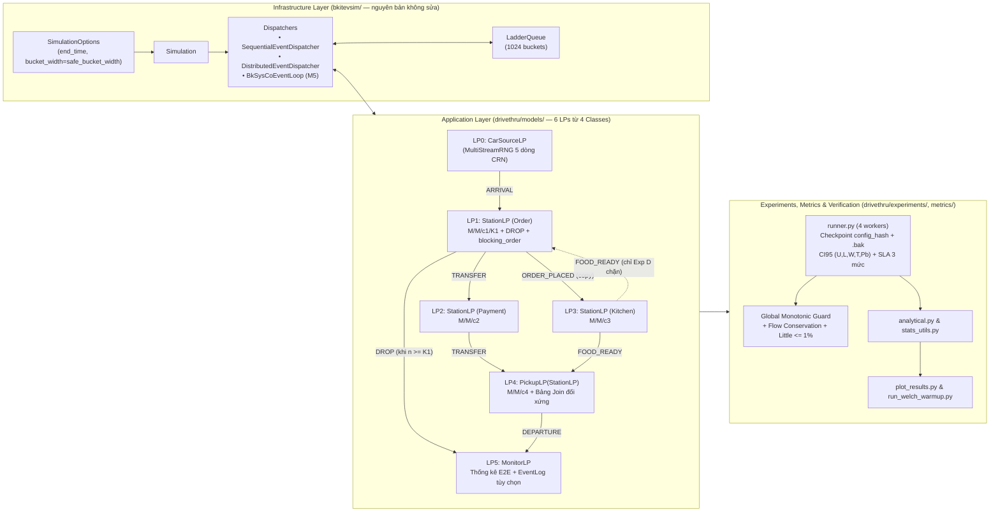
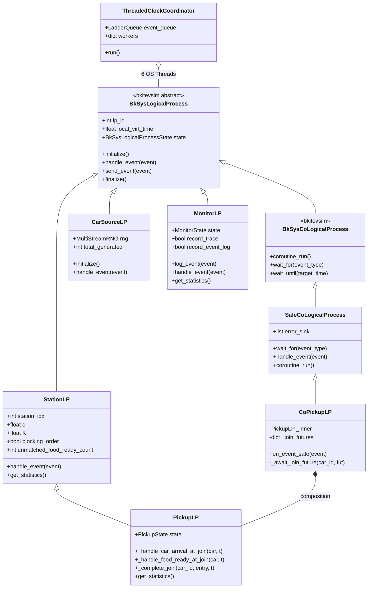

# Hồ sơ Kiến trúc, Sơ đồ Lớp & Đính chính Thiết kế (Phase 2)

Tài liệu bổ sung các mục bắt buộc cho hồ sơ Phase 2 của nhóm **SPE-L0x-008**: (1) Sơ đồ kiến trúc tổng thể, (2) Sơ đồ lớp kết nối `drivethru/` với `bkitevsim/`, (3) Tóm tắt Workload & Ma trận thí nghiệm, và (4) Bảng đính chính các điểm cập nhật so với Thiết kế V2 (Phase 1).

---

## 1. Sơ đồ Kiến trúc Hệ thống (Architecture Diagram)

---

## 2. Sơ đồ Lớp (Class Diagram)

---

## 3. Tóm tắt Workload & Thiết kế Thí nghiệm (Bước 7–8 PE)
* **Workload:** Quá trình đến Poisson ($\lambda \in \{0.2, 0.4, 0.6, 0.7\}$ xe/phút), thời gian phục vụ phân phối mũ độc lập ($1/\mu_1=1.5, 1/\mu_2=1.25, 1/\mu_3=1.5, 1/\mu_4=1.0$ phút), điều khiển bởi 5 luồng số ngẫu nhiên độc lập (`MultiStreamRNG`, CRN) gắn sẵn vào `CarRecord`.
* **Kiểm chứng giai đoạn quá độ (Welch):** `run_welch_warmup.py` chạy $R=60$ lượt không warm-up trên hai cấu hình tải nặng nhất ($c_2=1, K_1=8$, $\lambda=0.7$ và $0.6$), bỏ 4 bin cắt cụt + $w=5$ bin mép phải. Hệ thống bình ổn từ $t \approx 400$ phút $\implies$ mốc $t_{warmup}=2\,000$ phút dư an toàn.
* **Ma trận thí nghiệm:**
  * **Exp A (Validation):** 18 cấu hình (6 mô hình đơn $\times$ 3 mức tải) $\times R=30$ seeds ($t_{end}=20\,000$; riêng $M/M/1$ tải $0.9$ chạy $60\,000$).
  * **Exp B (Baseline & Fork–Join):** 4 cấu hình cơ sở ($c_2=1, K_1=8$) + 2 cấu hình $K_1=30$ (cơ sở và thu gọn $1/\mu_3=0.01$).
  * **Exp C (Sensitivity & Optimization):** Giai thừa đầy đủ $4(\lambda) \times 3(c_2) \times 4(K_1) = 48$ cấu hình, tự động mở rộng $R$ (tối đa 60) đến khi đạt CI 95% trên toàn bộ `U, L, W, T` ($\le 5$%), `P_b` ($\le 0.3$ điểm phần trăm) và thoát trạng thái `BOUNDARY` tại Peak.
  * **Exp D (Non-blocking vs. Blocking):** 6 cấu hình ($c_2=2, K_1=8$, $\lambda \in \{0.4, 0.6, 0.7\}$).
  * **M5 (Mở rộng 3 kiến trúc Engine):** 5 kịch bản (đa $t_{end}$ và đa $\lambda$) $\times$ 3 engine $\times R=10$ seeds đo tuần tự 1-core.

---

## 4. Đính chính & Cập nhật so với Thiết kế V2 (Phase 1)

| Mục trong Thiết kế V2 | Bản Phase 1 ban đầu | Cập nhật thực tế ở Phase 2 & Lý do |
|---|---|---|
| **Bảng 7 (`bucket_width`)** | Ghi mặc định `bucket_width = 1.0`. | **Đính chính thành `safe_bucket_width(t_end) = ceil(1.05 * (t_end + 100) / 1024)`** (11 cho $t_{end}=10\,000$, 21 cho $20\,000$, 62 cho $60\,000$). Với `1.0`, `LadderQueue` của `bkitevsim` chia lấy dư `% 1024` gây lỗi thời gian đi lùi khi $t \ge 1\,024$ (chứng minh ở `tests/test_m1_framework.py`). |
| **Bảng ánh xạ 1.8a (`MonitorLP` log)** | Ghi nhật ký từng event. | Đã bổ sung `MonitorLP.log_event()` kèm cờ `record_event_log=False` (bật khi chạy trace kiểm tay 10 xe -> ghi đủ 100% event theo thứ tự không giảm; tắt mặc định ở chạy batch để tránh tràn RAM). |
| **Mục 1.9 (Trace kiểm tay ~10 xe)** | Yêu cầu trace ~10 xe có DROP và chờ đồ. | Đã hiện thực `run_hand_trace.py` (seed=2, 13 xe, 3 DROP, 3 chờ đồ, 121 event, khớp công thức tay $< 10^{-12}$) và kiểm tự động trong `tests/test_m4_review_guards.py`. |
| **Mục 2.6 (Cấu hình đạt SLA tại Peak)** | Bảng 11 ước lượng sơ bộ bỏ qua blocking nên dự đoán $c_2=2, K_1=4$. | Thực nghiệm xác nhận nhận định ở cuối Mục 3.3.1: **`c2=1, K1=4`** là cấu hình nhỏ nhất đạt đúng 2 ngưỡng SLA tại Peak (nhờ ~3.2% xe bị chặn giảm tải cho Payment), còn **`c2=2, K1=6`** là cấu hình khuyến nghị vận hành thực tế (giảm mạnh $P_b$ xuống ~0.63%, giữ $U_2 < 0.8$ và đạt SLA ngay cả ở tải Heavy). |
| **Tên module thống kê** | `drivethru/metrics/statistics.py` | Đổi thành `drivethru/metrics/stats_utils.py` để tránh trùng tên module chuẩn `statistics` của Python. |
