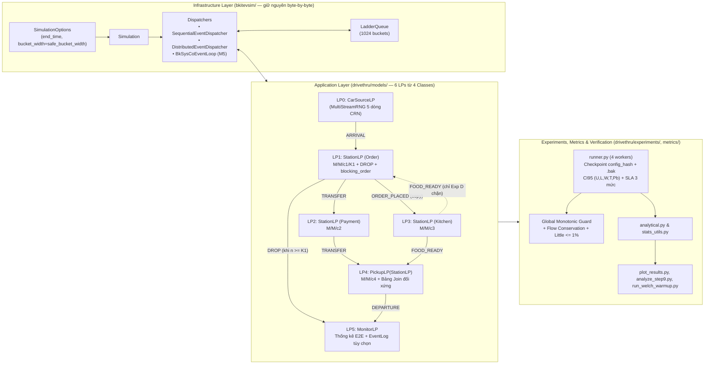
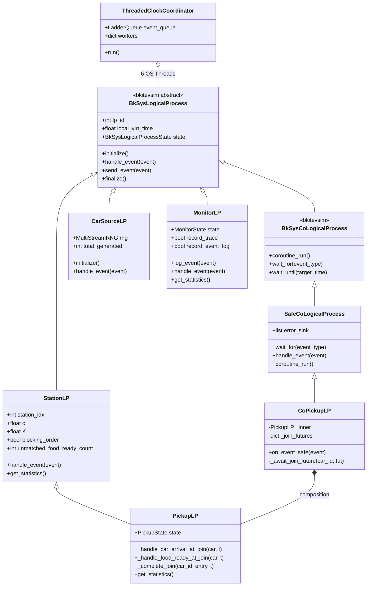

# Hồ sơ Kiến trúc, Đối chiếu Thiết kế & Đính chính (Phase 2)

Tài liệu kỹ thuật bổ trợ cho báo cáo Phase 2 của nhóm **SPE-L0x-008** (CO3007 — Lớp L02), gồm: (1) Sơ đồ kiến trúc, (2) Sơ đồ lớp, (3) Bảng đối chiếu từng lời hứa trong `Assignment_SPE_Design_v2.pdf` với mã nguồn/kiểm thử, (4) Kiểm toán từng dòng tham số Bảng 5–7, và (5) Bảng đính chính (Errata) cùng danh mục bổ sung ngoài thiết kế.

---

## 1. Sơ đồ Kiến trúc Hệ thống (Architecture Diagram)

---

## 2. Sơ đồ Lớp (Class Diagram)

---

## 3. Bảng Đối chiếu Lời hứa Thiết kế V2 $\leftrightarrow$ Hiện thực & Bằng chứng

| Mục Thiết kế V2 | Lời hứa / Yêu cầu trong Thiết kế | Bằng chứng trong Mã nguồn / Kiểm thử / Kết quả | Trạng thái |
|---|---|---|---|
| **Mục 1.8** *(Bảng ánh xạ bắt buộc)* | Ánh xạ `Arrival event` $\to$ `CarSourceLP`, `Server` $\to$ `StationLP`/`PickupLP`, `sys_op` $\to$ dispatcher, `process_op` $\to$ `BEGIN_SERVICE`/`END_SERVICE`, `Processing event` $\to$ `MonitorLP` log. | `drivethru/models/` (`car_source.py`, `station.py`, `pickup.py`, `monitor.py` với `log_event()` + `record_event_log`); `drivethru/core/event_types.py`. | **Đạt** |
| **Mục 1.9 (i)** | Cân bằng dòng khớp chính xác (chạy tự động mọi lượt Exp A–D). | `run_single.py` (`flow_balance_car`, `flow_balance_kitchen`), `run_exp_a.py`, `test_m2_station_gate.py`, `test_m3_network_gate.py::test_5`. | **Đạt** |
| **Mục 1.9 (ii)** | Định luật Little lệch $\le 1\%$ (chạy tự động mọi lượt Exp A–D). | `stats_utils.py::check_littles_law()`, `run_single.py`, `run_exp_a.py`, `reports/exp_c_little_audit.csv` (53/53 trung bình cấu hình $\le 0.31\%$; lượt đơn lẻ tối đa $1.83\%$ đã kiểm toán ở §9.4). | **Đạt** *(có ghi hạn chế lượt đơn lẻ)* |
| **Mục 1.9 (iii)** | Bảo toàn thông lượng $\lambda_{eff,2} = \lambda_{eff,3} = \lambda_{eff,4} = \lambda(1-P_b)$. | `tests/test_m3_network_gate.py::test_5`, cột `X1..X4` trong `reports/exp_bcd_raw_runs.csv`. | **Đạt** |
| **Mục 1.9 (iv)** | Exp A: giá trị lý thuyết nằm trong $CI_{95}$ hoặc sai số tương đối $\le 5\%$, đạt tiêu chí độ chính xác §2.5. | `drivethru/experiments/run_exp_a.py`, `reports/exp_a_validation.csv` (**144/144 chỉ số PASS**). | **Đạt** |
| **Mục 1.9 (v)** | Exp B với $K_1=30$: $\overline{T}$ mô phỏng lệch xấp xỉ Fork–Join $< 5\%$ (cả cơ sở lẫn thu gọn $1/\mu_3=0.01$). | `tests/test_m3_network_gate.py::test_6`, `reports/exp_b_summary.csv` (`B_FJ_K30_base`, `B_FJ_K30_deg`). | **Đạt** |
| **Mục 1.9 (vi)** | Cùng seed cho cùng kết quả (bất biến đảo thứ tự event trễ 0) và hai loại dispatcher cho cùng chỉ số. | `tests/test_m3_network_gate.py::test_4` (tính bất biến cùng seed & đảo thứ tự fork trễ 0); `tests/test_m3_network_gate.py::test_7` (`SequentialEventDispatcher` vs. `DistributedEventDispatcher` khớp $< 10^{-10}$). | **Đạt** |
| **Mục 1.9** *(Trace tay)* | Trace kiểm tay ~10 xe có ca bị từ chối (`DROP`) và ca chờ đồ ($W_f > 0$). | `drivethru/experiments/run_hand_trace.py`, `reports/hand_trace_10_cars.md` (13 xe, 3 DROP, 3 chờ đồ, 121 event), `test_m4_review_guards.py::test_8`. | **Đạt** |
| **Mục 2.5** *(Độ chính xác & CRN)* | Nửa độ rộng $CI_{95} \le 5\%$ cho `U, L, W, T` và $\le 0.3$ điểm % cho `P_b`; tự tăng `R` nếu chưa đạt; so sánh CRN dùng chung seed `1..R` lớn nhất của cặp. | `runner.py::check_precision_details()`, `run_exp_bcd.py::sync_exp_d_crn_pairs()`, `reports/exp_d_paired_crn.csv` (30 cặp ở $\lambda=0.4, 0.6$ và 40 cặp ở $\lambda=0.7$). | **Đạt** *(xem ghi chú §5.1)* |
| **Mục 2.6** *(SLA)* | Xét đồng thời $\overline{T} \le 8.0$ phút và $P_b \le 5.0\%$; phân loại 3 mức `PASS` / `FAIL` / `BOUNDARY`, chạy thêm khi ở biên giới. | `stats_utils.py::evaluate_sla_status()`, `runner.py`, `run_exp_bcd.py` (cột `sla_status`), `test_m4_review_guards.py::test_2, test_7`. | **Đạt** |
| **Bảng 12 — Exp A** | 6 mô hình đơn ($M/M/1, M/M/1/K, M/M/\infty, M/M/n/n, M/M/c, M/M/c/K$) qua `CarSourceLP -> StationLP -> MonitorLP`, 3 mức tải, $R=30$, $t_{end}=20\,000$ ($60\,000$ cho $M/M/1$ tải $0.9$). | `experiment_config.py::get_exp_a_configs()`, `run_exp_a.py`, `reports/exp_a_validation.csv`. | **Đạt** |
| **Bảng 12 — Exp B** | Baseline $c_2=1, K_1=8$ (4 mức $\lambda$, dùng chung tập con Exp C) + 2 cấu hình đối chiếu $K_1=30$ tại $\lambda=0.6$. | `experiment_config.py::get_exp_bcd_configs()`, `reports/exp_b_summary.csv`. | **Đạt** |
| **Bảng 12 — Exp C** | 48 cấu hình giai thừa đầy đủ ($4 \times 3 \times 4$), đồ thị $\overline{T}, P_b$ và cấu hình tối thiểu đạt SLA. | `reports/exp_c_summary.csv` (48/48 `precision_ok`), `exp_c_min_sla_configs.csv`, `fig1`–`fig3`, `fig9`, `fig10`. | **Đạt** |
| **Bảng 12 — Exp D** | $c_2=2, K_1=8$, $\lambda \in \{0.4, 0.6, 0.7\}$, Non-blocking vs. Blocking, 6 cấu hình. | `reports/exp_d_summary.csv`, `reports/exp_d_paired_crn.csv`, `fig5_exp_d_blocking_vs_nonblocking.png`, `test_m3_network_gate.py::test_7`. | **Đạt** |
| **Mục 3.4** *(5 biểu đồ)* | 5 biểu đồ dự kiến: (1) $\overline{T}$ & $P_{95}(T)$ theo $\lambda, c_2$; (2) $P_b$ theo $K_1$; (3) $U_i$ 4 trạm; (4) Exp A lý thuyết vs. mô phỏng; (5) Exp D cột so sánh $\overline{T}, P_b, U_1$. | `drivethru/experiments/plot_results.py` $\to$ `reports/fig1` .. `fig5` (đều có thanh sai số $CI_{95\%}$). | **Đạt** |

---

## 4. Kiểm toán Từng dòng Tham số (Bảng 5, Bảng 6, Bảng 7 $\leftrightarrow$ Mã nguồn)

Đối chiếu trực tiếp với `drivethru/config/simulation_config.py` và `drivethru/config/experiment_config.py`:

| Nguồn Thiết kế V2 | Tham số & Giá trị Thiết kế | Hiện thực trong Mã nguồn | Đối chiếu |
|---|---|---|---|
| **Bảng 5** (Hệ thống) | $c_1=2$, $1/\mu_1=1.5$p, $K_1 \in \{3,4,6,8\}$ (factor) | `DriveThruParams`: `c1=2`, `mean_s1=1.5`; `get_exp_bcd_configs`: `k1_levels=[3, 4, 6, 8]` | Khớp 100% |
| **Bảng 5** (Hệ thống) | $c_2 \in \{1,2,3\}$ (factor), $1/\mu_2=1.25$p, $K_2=\infty$ | `get_exp_bcd_configs`: `c2_levels=[1, 2, 3]`; `mean_s2=1.25`; `run_single.py`: `K=math.inf` | Khớp 100% |
| **Bảng 5** (Hệ thống) | $c_3=2$, $1/\mu_3=1.5$p, $K_3=\infty$ | `DriveThruParams`: `c3=2`, `mean_s3=1.5`; `run_single.py`: `K=math.inf` | Khớp 100% |
| **Bảng 5** (Hệ thống) | $c_4=2$, $1/\mu_4=1.0$p, $K_4=\infty$ | `DriveThruParams`: `c4=2`, `mean_s4=1.0`; `PickupLP`: `K=math.inf` | Khớp 100% |
| **Bảng 5** (Hệ thống) | Quy ước $K = w + c$ (tính cả xe đang phục vụ), kỷ luật FCFS | `StationLP._handle_arrival`: `busy + len(queue) >= K`; `queue = deque()` (`append`/`popleft`) | Khớp 100% |
| **Bảng 6 & 10** (Workload) | Poisson $\lambda \in \{0.2, 0.4, 0.6, 0.7\}$ (Light/Normal/Peak/Heavy), dịch vụ mũ, CRN tách luồng | `MultiStreamRNG` (5 luồng độc lập: 1 đến + 4 trạm), gắn `service_times` vào `CarRecord` lúc sinh xe | Khớp 100% |
| **Bảng 7** (Mô phỏng) | $t_{end}=10\,000$p (Exp B–D), $20\,000$p (Exp A), $60\,000$p ($M/M/1, \rho=0.9$); $t_{warmup}=2\,000$p | `DriveThruParams(t_warmup=2000.0, t_end=10000.0)`; `get_exp_a_configs()` (`20000.0` và `60000.0`) | Khớp 100% |
| **Bảng 7** (Mô phỏng) | $R = 30$ cơ sở, Seed `1..30` (tăng `R` theo §2.5 nếu chưa đạt CI), Dispatcher `Sequential` | `base_replications=30`, `max_replications=60` (trần nhóm chọn), `dispatcher="sequential"` | Khớp *(xem §5.1)* |
| **Bảng 7** (Mô phỏng) | `bucket_width = 1.0` | **`safe_bucket_width(t_end) = ceil(1.05 * (t_end + 100) / 1024)`** (11 / 21 / 62) | **Đính chính có chủ đích (xem §5.1)** |

---

## 5. Bảng Đính chính (Errata) & Danh mục Phần Bổ sung ngoài Thiết kế

### 5.1. Các điểm Đính chính / Chi tiết Triển khai so với Thiết kế V2

| Mục | Thiết kế V2 (Phase 1) ghi gì | Thực tế Phase 2 làm gì | Lý do kỹ thuật |
|---|---|---|---|
| **Bảng 7 (`bucket_width`)** | Ghi mặc định `bucket_width = 1.0`. | Dùng `safe_bucket_width(t_end)` = 11 ($10\,000$p), 21 ($20\,000$p), 62 ($60\,000$p). | `LadderQueue` của `bkitevsim` chia lấy dư `% 1024` nên `1.0` gây lỗi thời gian đi lùi khi $t \ge 1\,024$ (`test_m1_framework.py::test_1, test_3`). |
| **Tên module thống kê** | `drivethru/metrics/statistics.py`. | Đổi thành `drivethru/metrics/stats_utils.py`. | Tránh trùng tên (shadowing) module chuẩn `statistics` của Python. |
| **Bảng 1.8 (`MonitorLP` log)** | Ghi bản ghi log cho mỗi event. | Thêm `MonitorLP.log_event()` điều khiển qua cờ `record_event_log=False`. | Bật khi chạy trace kiểm tay 10 xe (ghi đủ 100% event đơn điệu); tắt mặc định ở chạy batch để tránh phình bộ nhớ. |
| **Mục 2.6 & 3.3.1 (Cấu hình tối thiểu tại Peak)** | Bảng 11 ước lượng sơ bộ bỏ qua blocking nên dự đoán $c_2=2, K_1=4$. | Ghi nhận đúng số đo thực tế: **`c2=1, K1=4`** là cấu hình nhỏ nhất đạt SLA tại Peak; **`c2=2, K1=6`** là cấu hình khuyến nghị vận hành. | Khớp đúng dự liệu ở cuối §3.3.1: ~3.2% xe bị từ chối ở Order làm giảm $\lambda_{eff}$ vào Payment nên kéo $\overline{T}$ xuống $< 8$ phút. |
| **Mục 2.5 & 3.4 (Số lần lặp `R`)** | $R=30$ cơ sở; cấu hình chưa đạt độ chính xác được tăng `R` (không quy định trần tối đa); so sánh CRN dùng chung seed `1..R` lớn nhất của cặp. | Thực hiện đúng cơ chế tăng `R` theo §2.5 & §3.4 với trần cài đặt nhóm chọn `max_replications = 60`. Kết quả Phase 2: Exp C mở rộng `C_lam7_c2_1_K1_6` ($R=50$) và `C_lam7_c2_1_K1_8` ($R=60$); Exp D tại $\lambda=0.7$ biến thể chặn đạt chuẩn ở $R=40$ và biến thể không chặn (`C_lam7_c2_2_K1_8`) được đồng bộ lên $R=40$ để so ghép cặp trên trọn 40 cặp seed `1..40`. | Đảm bảo 100% cấu hình đạt tiêu chí chính xác $CI_{95\%}$ và tuân thủ quy định ghép cặp CRN §2.5; giới hạn trần `60` giúp kiểm soát thời gian chạy mà vẫn đạt 48/48 `precision_ok`. |
| **Mục 2.5 (Ngưỡng `0.3` điểm % cho $P_b$)** | Thiết kế nêu tiêu chí nửa độ rộng $CI_{95}(P_b) \le 0.3$ điểm % (và ở Exp A chỉ lấy cấu hình có $P_b$ lý thuyết $\ge 1\%$ làm bằng chứng kiểm chứng $P_b$). | Trong `runner.py`, áp dụng đồng nhất ngưỡng $CI_{95}(P_b) \le 0.003$ (0.3 điểm %) cho **mọi cấu hình mạng** Exp B–D (kể cả khi $P_b$ rất nhỏ gần 0%). | Kiểm tra thống nhất, chặt hơn và an toàn: khi $P_b \approx 0\%$ thì phương sai mẫu cũng rất nhỏ nên nửa độ rộng tự nhiên $\ll 0.003$. |

### 5.2. Các nội dung Bổ sung / Mở rộng ngoài lời hứa ban đầu (không thay đổi yêu cầu lõi)
* **Kiểm chứng Warm-up bằng phương pháp Welch (`run_welch_warmup.py`, `fig0`):** Thực hiện lời hẹn ở Bảng 4 §2.5 và Bảng 7 §3.1.2 ($R = 60$, bỏ $w = 5$ bin mép phải).
* **Phân bổ phương sai có `SSE` (`analyze_step9.py`, `exp_c_sensitivity_anova.csv`, `fig10`):** Bổ sung theo bài giảng `pe9`–`pe10` trên 1 440 lượt chạy Exp C (30 seed đầu của 48 cấu hình).
* **Đồ thị đánh đổi Pareto $\overline{T}$–$P_b$ & Bảng cấu hình tối thiểu theo $\lambda$ (`fig9`, `exp_c_min_sla_configs.csv`):** Làm rõ tính ngược chiều giữa $\overline{T}$ và $P_b$ ở §2.6.
* **So sánh ghép cặp CRN (`exp_d_paired_crn.csv`):** Tính $CI_{95\%}$ cho hiệu từng cặp $\Delta_r$ ở Exp D (30 cặp ở $\lambda=0.4, 0.6$ và 40 cặp ở $\lambda=0.7$).
* **Kiểm toán Định luật Little (`exp_c_little_audit.csv`):** Định lượng sai số trung bình cấu hình vs. lượt đơn lẻ theo §2.4.7.
* **3 kiểm thử Verification bổ sung (`test_m4_review_guards.py::test_9..11`):** Phủ trọn 9 kỹ thuật của `pe7` (Deterministic, Continuity, Seed Independence).
* **Phần mở rộng tùy chọn M5 (`drivethru/engines/`, `fig6`–`fig8`):** So sánh 3 kiến trúc thực thi DES (`sequential_engine.py`, mô hình lai `coroutine_engine.py` bọc Composition + `BkSysFuture`, `multithread_engine.py` 6 OS threads + thí nghiệm đối chứng `run_m5_speedup_probe.py`), tách riêng tại Phụ lục A của báo cáo.
